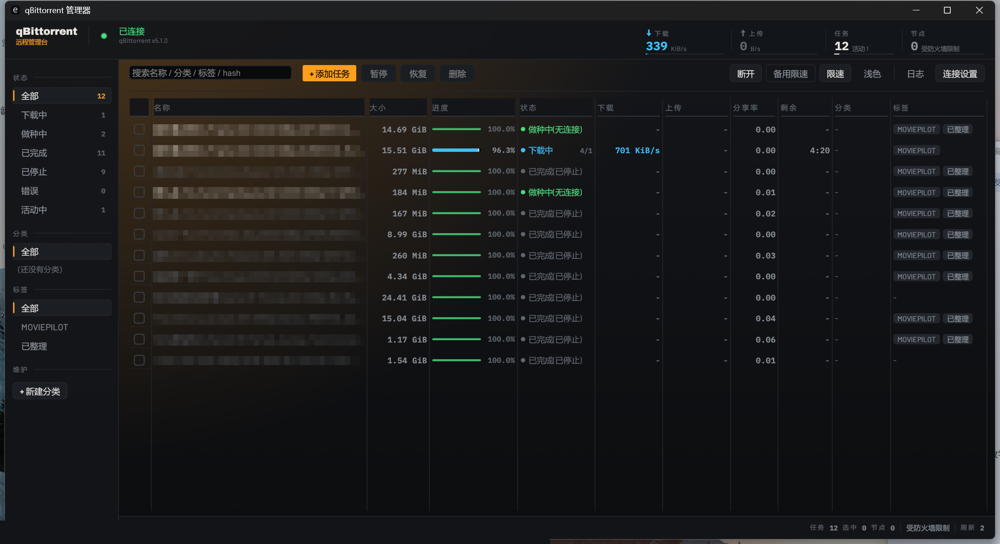
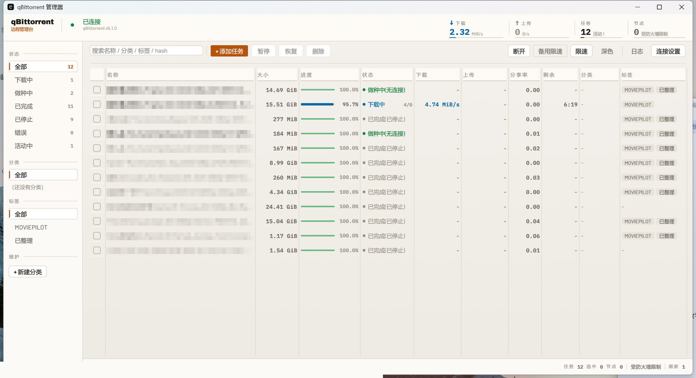

# qb-client

[](https://github.com/KingNuoNuo/qb-client/actions/workflows/build.yml)
[](https://github.com/KingNuoNuo/qb-client/stargazers)
[](https://github.com/KingNuoNuo/qb-client/network/members)
[](https://github.com/KingNuoNuo/qb-client/watchers)
[](https://github.com/KingNuoNuo/qb-client/issues)
[](LICENSE)
[](https://github.com/KingNuoNuo/qb-client/releases/latest)
[](https://github.com/KingNuoNuo/qb-client/commits/main)
[](https://github.com/KingNuoNuo/qb-client)

[⬇️ 下载](https://github.com/KingNuoNuo/qb-client/releases/latest) · [🐛 反馈问题](https://github.com/KingNuoNuo/qb-client/issues) · [💡 功能建议](https://github.com/KingNuoNuo/qb-client/issues)

`qBittorrent` `Rust` `egui` `Desktop App` `Torrent` `Download Manager` `Cross-platform` `Windows` `macOS` `NAS` `Self-hosted` `WebUI`

**简体中文** | [English](README.en.md)

Rust + egui 写的 **qBittorrent 桌面管理客户端**（Windows / macOS），直接对接 qBittorrent WebAPI v2，
兼容 **qBittorrent 5.x**（含 5.1.0，已在代码里处理 5.0 把 `paused*` 状态改名为 `stopped*` 的变更）。

产物是**单个可执行文件**（Windows 一个 exe；macOS 一个 `.app`），不依赖 WebView / Node / 运行时。
字体（约 800KB）已内嵌进二进制。

---

## 截图

> 截图中的种子名称等隐私信息已打码。

**深色**



**浅色**



---

## 界面设计

视觉方向是 **工业实用（Industrial / Utilitarian）** —— 仪表盘密度、等宽数字、发丝边框，
刻意远离"通用后台模板"那套圆角卡片 + 均匀配色的观感。

| 层 | 决策 |
|---|---|
| **展示字** | Archivo Black（工业 grotesque），只用于品牌字样 |
| **界面正文** | Barlow（DIN 系骨架，R / M / SB 三档真字重） |
| **数字** | IBM Plex Mono（SemiBold / Bold）—— 表格里所有数值等宽对齐 |
| **中文** | 不内嵌，运行时从系统字体目录按平台候选表取（Windows 微软雅黑 / macOS 苹方 / Linux Noto CJK），避免 exe 膨胀十几 MB |
| **底色** | 暖调近黑 `#0C0D0F`，不是纯黑也不是蓝黑；亮色主题用暖灰画布 `#EDEAE3` + 米白面板 `#F8F6F2` |
| **强调色** | 琥珀 `#FF9F1C`（亮色主题换成 `#B45309` 保证对比度 ≥ 4.5:1），**全屏只有一个**，只给选中态和主操作 |
| **状态色** | 下载青 `#3FC1FF` / 上传绿 `#4ADE80` / 校验橙 `#F5A524` / 错误红 `#FF5C5C`，是独立的语义层 |
| **圆角** | 2 / 4 / 6pt 三档。工业风的关键是发丝线和直角，不是圆润 |

**氛围层**（`widgets::backdrop`）画在 `Order::Background` 图层上，中央面板是透明的，
所以氛围能从内容底下透出来。内容只有两层：**垂直渐变底 + 左上角琥珀径向光晕**
（用三角扇模拟，epaint 没有径向渐变原语）。

亮色主题下**刻意关掉光晕**（令牌置为全透明）—— 琥珀压在奶油色画布上只会变成一摊脏黄渍，
把画布和行底色一起染暖，还会让画布比面板更亮、把"面板浮在画布上"的层级关系整个抹平。
亮色改由表面层级（画布 → 面板 → 白）造纵深。

> **背景不放任何纹理**（早先有过一层 48pt 发丝网格，两套主题都调过强度之后**彻底退役**）。
> 数据密集的界面里背景图案必然和内容抢注意力：压到看不见时等于不存在，抬到看得见时就是
> 方格纸，中间没有"刚好的档位"。需要质感就用间距、发丝线、字重去表达。

**可访问性**：交互控件（按钮 / 输入框 / 下拉 / 勾选）一律沿用 egui 内置实现，只换视觉，
所以键盘聚焦、Tab 遍历、焦点圈都是原生的；只有纯展示元件（遥测带、进度条、状态点、区块标题、导航条）
才自绘，自绘的导航条额外补了 `Sense::click` 焦点链 + Enter/Space 激活 + 2pt 焦点圈。
所有圆点、箭头、加号、警告三角都由 painter 现画几何图形，不依赖 `● ↑ ↓ ＋ ⚠` 字形 ——
那些字符在部分字体里缺字，是中文界面上最常见的"方块"来源。

**动效**：行悬停 120ms、导航选中 130ms、进度条数值 320ms 平滑插值（进度跳变会"闪"，
平滑之后能直接看出速度差异）。全部走 `ctx.animate_*`，主题/时长改 `theme.rs` 一处即可。

---

## 功能

| 模块 | 内容 |
|---|---|
| 连接 | 主机 / 端口 / 用户名 / 密码 / HTTPS / 忽略证书；启动自动连接；配置持久化 |
| 任务列表 | 名称、大小、进度条、状态、上下行速度、分享率、剩余时间、分类、标签；点表头排序；关键字搜索 |
| 筛选 | 状态（全部/下载中/做种中/已完成/已停止/错误/活动中）、分类、标签，左侧栏带实时计数 |
| 添加 | 多行 magnet / URL 批量提交；本地 `.torrent` 文件上传；自定义保存路径、分类、标签、添加后暂停、顺序下载 |
| 控制 | 暂停 / 恢复 / 删除（可选删除数据） / 强制开始 / 顺序下载 / 重新校验 / 重新汇报 Tracker / 移动路径 |
| 限速 | 全局上下行限速、单任务独立限速、备用限速模式开关 |
| 分类标签 | 新建分类、批量改分类、批量加/删标签（右键菜单里也能对单个任务改） |
| 其他 | 任务详情（五个模块：常规 / Trackers / 节点 / HTTP 源 / 内容，列对齐原生 WebUI）、操作日志、深浅色主题、顶栏实时遥测带、主题与窗口尺寸记忆 |
| 多语言 | 简体中文 / 英文，**跟随 qBittorrent WebUI 的语言设置** —— 连接后读 `/app/preferences` 的 `locale` 自动切换，WebUI 里改语言约 15 秒内生效；尚未翻译的条目回退中文。状态、优先级、连接标志、操作日志、报错信息都在翻译范围内 |
| 显示适配 | 全部坐标用逻辑点，跟随系统 DPI 缩放（100%~200%）不糊不变形；窗口尺寸跨显示器自动钳进可用区；界面缩放可再叠一档（设置 → 显示，或 Ctrl + / − / 0） |

---

## 下载预编译版本

| 平台 | 产物 | 说明 |
|---|---|---|
| Windows x64 | `qb-client-windows-x64.exe` | 单文件，双击即用 |
| macOS Apple Silicon | `qb-client-macos-arm64.zip` | 解压得 `qb-client.app`，拖进「应用程序」 |
| macOS Intel | `qb-client-macos-x86_64.zip` | 同上 |

- **每次 push 到 `main` 都会自动编译三端**，产物在 Actions 的 Artifacts 里；
- 打 `v*` 标签（`git tag v0.1.0 && git push --tags`）会额外把这些产物**附到 GitHub Release**。
- macOS 未签名，见「已知限制」的 Gatekeeper 说明。

---

## 构建

### 1. 装 Rust

到 <https://rustup.rs> 下载 `rustup-init.exe` 安装，默认选项即可（会自动装 MSVC 工具链）。
若提示缺少 C++ 生成工具，装一个 **Visual Studio Build Tools**（勾选「使用 C++ 的桌面开发」）。

验证：

```bash
cargo --version
```

### 2. 国内网络：配 crates 镜像（可选，但强烈建议）

编辑 `C:\Users\<你>\.cargo\config.toml`（没有就新建）：

```toml
[source.crates-io]
replace-with = "aliyun"

[source.aliyun]
registry = "sparse+https://mirrors.aliyun.com/crates.io-index/"
```

> 备选源：`sparse+https://rsproxy.cn/index/`（字节）、`sparse+https://mirrors.ustc.edu.cn/crates.io-index/`。
> 用哪个先 `curl -s -o /dev/null -w "%{http_code}" -m 12 <源URL>` 探一下，返回 200 再用。

### 3. 编译

```bash
cd D:/workbuddy/qb/qb-client
cargo build --release
```

首次编译要拉依赖 + 编完整依赖树。配好镜像后实测 **约 100 秒**（egui 全家桶 400+ crate）；
没配镜像直连 crates.io 可能 3–8 分钟。之后增量编译只要 **30 秒**上下。

产物：`target\release\qb-client.exe`（约 8–12 MB，已 strip）。

也可以直接双击 `build.bat`。

### 验证记录

- **编译**：`cargo build --release`（rustc 1.99.0 / cargo 1.99.0 / Windows MSVC）**零错误零警告**通过，
  产物 `qb-client.exe` **10.6 MB**（`strip` + thin LTO）。
- **运行**：连上 qBittorrent **5.1.0**（WebAPI 2.11.6），12 个任务全部正确读出；
  表格 / 筛选 / 遥测带 / 状态栏 / 深浅色主题渲染正常，截图见开头。
- **背景去纹理的验证**：对同一窗口矩形做像素逐点扫描 —— 移除前在 x=2026 / 2098 / 2170
  采到三根竖线（间距 72px = 150% 缩放下的 48pt），移除后同一扫描线 `jumps=0`，
  纵向扫描里的四根横线也全部消失。

---

## 使用

1. 运行 `qb-client.exe`（macOS 是 `qb-client.app`）。
2. 点右上角「连接设置」，填 qBittorrent WebUI 的地址、端口、账号、密码。
3. 点「保存并连接」。连上后左上角显示 `已连接 qBittorrent v5.1.0 · WebAPI 2.11.x`。
4. 配置存于 `%APPDATA%\qb-client\config.json`（**密码是明文**，注意保管）。

### 小提示

- **双击任务行**打开详情；**右键任务行**是快捷操作菜单（含设为分类 / 加减标签 / 移动保存路径 / 复制 hash）。
- **选中**：单击行 = 只选中它；点勾选框、按住 Ctrl(⌘)、按住 Shift、或按回车 = 切换这一行的选中态。
  选中若干行后，用工具条上的「暂停 / 恢复 / 删除」，或用第二行浮出的批量条打分类 / 标签。
- 顶栏右侧是遥测带：节点数、任务数（含活动数）、上下行实时速度。每块底下的细条是「读数条」——
  设了限速就显示限速占用率，没设就按 20 MiB/s（下行）/ 10 MiB/s（上行）折算。
- 搜索框里按 **Esc** 可直接清空搜索条件。
- **深浅色主题与窗口尺寸会被记住**，下次启动照旧（存在 eframe 的本地配置里，与 `config.json` 分开）。
- 轮询间隔默认 2 秒，设置里可调（1–60 秒）。改完点「仅保存」立刻生效，且**不会断开会话**。

---

## 性能：轮询分两条通道

qB 的 WebAPI 里，任务列表和传输速率是秒级变化的，但**分类、标签、备用限速开关、全局限速值
几秒内根本不会动**。把它们塞进同一个轮询周期，等于大部分请求都在问一批不会变的答案。

所以拆成两条：

| 通道 | 内容 | 频率 |
|---|---|---|
| 快 | `torrents/info` + `transfer/info` | 每个轮询周期（默认 2s） |
| 慢 | 分类 / 标签 / 备用限速 / 全局限速 | 15 秒，且**任何写操作后强制走一次** |

稳态请求量从 **7 个/轮** 降到 **2 个/轮**（约 −70%）。写操作后强制全量是为了保证
「刚建完分类、刚打完标签，下一帧就能在界面上看到」，不用等那 15 秒。

---

## 代码结构

```
src/
├── main.rs     入口，eframe 启动、窗口尺寸
├── config.rs   连接配置读写（%APPDATA%\qb-client\config.json）
├── theme.rs    设计系统：调色板 + 字阶 + 间距/圆角令牌 + 全局样式安装
├── fonts.rs    字体装载：内嵌 Archivo Black / Barlow / IBM Plex Mono，中文运行时回退
├── widgets.rs  自绘元件：氛围背景、遥测带、进度条、状态点、导航条、行背景
├── model.rs    WebAPI 数据结构（Torrent / TransferInfo / Tracker / Category）+ 状态中文映射
├── api.rs      WebAPI v2 封装（认证、任务、限速、分类标签、Tracker）
├── worker.rs   后台网络线程：轮询刷新 + 指令串行执行 + 会话失效自动重登
├── app.rs      UI 布局与交互：顶栏 / 左栏 / 工具条 / 表格 / 状态栏 / 各弹窗
└── util.rs     格式化（大小 / 速度 / 时长 / 时间戳）
assets/fonts/   三套 SIL OFL 字体 + 许可全文（OFL.txt）
```

架构要点：**UI 线程永不阻塞**。所有 HTTP 请求都在 `worker.rs` 的单个后台线程里串行执行，
UI 每帧只做一次短锁读取快照（`Snap`），用户操作通过 `mpsc` channel 下发。

设计要点：**布局代码里不出现任何色值**。所有颜色都从 `theme::pal(self.dark)` 取，
主题切换只是换一个调色板 + 重灌一次样式（`theme::install`）。调色板是 `&'static Palette`，
可以随便复制进闭包，不会和 `&mut self` 打架。

`_static_check.py` 是个轻量静态体检脚本：查括号配平、重复定义（按 `impl` 块区分）、
跨模块引用的符号是否存在、每个函数的调色板绑定是否漏了。不依赖 Rust 工具链，
适合在改动后快速扫一遍（正式的检查当然还是 `cargo check`）。跑法：

```bash
python _static_check.py
```

---

## 兼容性说明

- 对接 **WebAPI v2**（qBittorrent 4.1+）。
- 状态字符串同时识别 `pausedDL/pausedUP`（4.x）与 `stoppedDL/stoppedUP`（5.x）。
- 所有结构体字段带 `#[serde(default)]`，qB 增删字段不会导致解析失败。
- `pause` / `resume` 端点两边都保留，无需按版本分支。
- Tracker 字段名若在未来的 qB 版本变动，只会显示为空，不影响其它功能。

## 已知限制

- 不支持拖拽文件到窗口添加种子（用「添加任务」窗口选文件）。
- 不支持 RSS 订阅管理、搜索插件、完整 Preferences 编辑（属「全量功能」范围，未实现）。
- IPv6 环境下若 qB WebUI 只监听 IPv4，请填 IPv4 地址。
- **macOS 产物由 GitHub Actions 编译，本地没跑过**。UI 是跨平台的（egui），
  平台差异集中在两处：标题栏配色只在 Windows 生效；中文字体按平台候选表取
  （macOS 用苹方）。第一次跑 macOS 如有问题看 Actions 日志。
- **macOS 未签名**：首次打开会被 Gatekeeper 拦，右键 → 打开，或
  `xattr -cr /Applications/qb-client.app` 放行一次即可。
- 滚动条粗细用的是 egui 默认值，没做细调（`ScrollStyle` 的字段在各版本间不稳定，先不动）。
- 顶栏遥测带是固定宽度（总计约 460pt），窗口窄于 ~1100pt 时会挤在一起；主界面按 1440pt+ 设计。
- qB 的 IPv6 tracker 走不通时状态会显示为「受防火墙限制」，这是 qB 侧的连接状态，不是本客户端的问题。

---

## 许可证 / License

本项目以 [MIT 许可证](LICENSE) 开源。

<!-- traffic:start -->

## 📊 访问统计


| 指标 | 近 14 天 |
| --- | ---: |
| 页面浏览量 | 24 |
| 独立访客 | 6 |
| 克隆次数 | 257 |
| 独立克隆者 | 107 |

<sub>数据窗口 2026-10-06 ~ 2026-10-19 · 由 GitHub Actions 每日更新于 2026-10-20 · 来源：GitHub Traffic API（仅统计最近 14 天）</sub>

<!-- traffic:end -->
